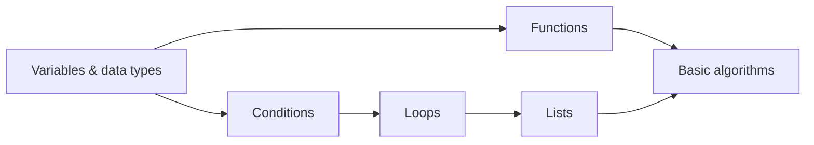

# MVP scope (presentation: Saturday, October 31, 2026)

Status: **Approved** (G0 baseline, owner, 2026-10-25).

## Reality check

Phase 0 started on **Sunday, October 25, 2026**, which leaves **about five working days** before the presentation. That is enough for **one polished, complete learning loop on one subject**. It is not enough for real accounts, a content admin, or truly adaptive question selection. This scope is sized for that.

**What "presentation-ready" means:** a live demo on the team's laptop (D-10) where a presenter goes through journey J2 ([requirements](requirements.md#j2-core-learning-loop-the-demo-path)) in Tajik, Russian, and English and in both themes, without errors. A recorded backup video exists. It doesn't mean deployed for real users.

## Demo subject: introductory Informatics

Approved subject (D-08): **Introductory Computer Science / Informatics**. Code examples optionally use Python, for teaching only. Python isn't part of the application stack (D-20).

| # | Topic (slug) | Direct prerequisites | Map column |
| --- | --- | --- | --- |
| 1 | Variables and data types (`variables`) | — | 0 |
| 2 | Conditions (`conditions`) | variables | 1 |
| 3 | Functions (`functions`) | variables | 1 |
| 4 | Loops (`loops`) | conditions | 2 |
| 5 | Arrays / lists (`lists`) | loops | 3 |
| 6 | Basic algorithms: sum, max, linear search (`algorithms`) | functions, lists | 4 |

**Does the sequence support meaningful prerequisites and mastery?** Yes:

- **Depth:** the longest chain is 5 topics (Variables → Conditions → Loops → Lists → Algorithms). "Prerequisite first" therefore has real choices to make.
- **Two branches meet:** Algorithms needs both Functions and Lists, so the map shows a real graph, not a straight line.
- **Each prerequisite is genuinely needed:** loops use conditions to stop, iterating over a list needs a loop, and the algorithms are functions over lists. Recommendations will make sense to a teacher watching.
- **Testable with single-choice questions:** "What does this code print?", "Which condition is true when…?", and "How many times does this loop run?" all have exactly one correct answer, plus an explanation.
- The topic order 1→6 is a valid study order: every prerequisite comes before its dependents.

### Demo storyline (scripted, verified on Friday)

1. Open `/tg` first (Russian is the default since 2026-10-26, so `/` opens `/ru`), or switch to Тоҷикӣ in the language menu. In Tajik, choose demo learner **Farzona**. Her seeded history: Variables **mastered**, Conditions **weak** (50%), everything else **not started**. The Knowledge Map shows this immediately.
2. Open **Loops**, read the lesson, mark it complete, and take the Loops quiz, answering 2 of 4 questions wrongly. Result: Loops **weak** (50%).
3. Recommendations: **1. Conditions lesson** ("Prerequisite for Loops"), then **2. the recommended Loops book** ("You scored 50% on Loops"). The book appears because the Loops lesson is already completed ([ADR-0004](../01-architecture/adr/0004-rule-based-mastery-and-recommendations.md)).
4. Review Conditions and retake the Conditions quiz → **mastered**. The progress page and map update.
5. Switch to Russian, then English, and to dark theme, to show the same page fully translated.
6. Optional: "Continue as guest" to show a fresh learner.

## MVP content

| Item | Amount | Languages |
| --- | --- | --- |
| Subjects | 1 (Informatics) | tg, ru, en |
| Topics | 6 (table above) | tg, ru, en |
| Lessons | 1 per topic: explanation, ≥ 1 Python worked example, key takeaways | tg, ru, en |
| Topic quizzes | 1 per topic, **4 questions each** (24 total), each with an explanation | tg, ru, en |
| Resources | 1–2 per topic (at least one book across the subject) | descriptions in tg, ru, en. The resource itself may be in one language, which is shown |
| Checkpoint quiz (MVP-Should) | 1 multi-topic quiz, 3 questions per topic it covers | tg, ru, en |
| Demo learners | 2 (Farzona: the storyline above; Rustam: most topics mastered) | names only |

All core content exists in all three languages (D-06). Python code stays identical across languages; comments and explanations are translated.

## In scope for the MVP

| Feature | MVP version | Priority | Requirement IDs |
| --- | --- | --- | --- |
| Subject and topic catalog | List subjects, subject page with ordered topics and status | MVP-Must | FR-CAT-01..03 |
| Structured lessons | Read lesson, mark complete, next step | MVP-Must | FR-LES-01..03 |
| Recommended books and resources | Listed per topic and in recommendations | MVP-Must | FR-RES-01..02 |
| Quizzes | Single-choice questions, server scoring, explanations, per-topic breakdown, retake | MVP-Must | FR-QUIZ-01..06 |
| Adaptive Quiz (analysis) | Rule-based weak-topic detection + up to 3 recommendations, prerequisites first | MVP-Must | FR-ADAPT-01..03 |
| Learning progress | Topic mastery + progress page with attempts and completed lessons | MVP-Must | FR-PROG-01..02 |
| Multilingual UI | Russian default, switcher, persisted, correct formatting | MVP-Must | FR-I18N-01..04 |
| Light / dark / system | Theme switcher, no flash, correct logo | MVP-Must | FR-THEME-01..03 |
| Demo profiles + guest mode | Choose a demo learner or continue as guest, demo reset | MVP-Must | FR-AUTH-01..04 |
| **Knowledge Map** | Graph with status, keyboard navigation, **list view** alternative | **MVP target** (graph view is MVP-Should, list view is MVP-Must) | FR-MAP-01..04 |
| Learning Journey (history) | Per-topic score trend on the progress page | MVP-Should | FR-JOUR-01 |
| Checkpoint quiz | One multi-topic quiz | MVP-Should | (content) |
| Motion | Subtle transitions, respects reduced motion | MVP-Should | (design system) |

**Cut order if behind schedule** (decided at the feature freeze, Friday 12:00): Motion polish → checkpoint quiz → FR-JOUR-01 trend → Knowledge Map **graph** view (the list view stays, so the map's information is still shown). MVP-Must items are not cut. If one is at risk, raise it immediately.

## Deferred (after the presentation)

| Feature | Notes |
| --- | --- |
| Adaptive question selection (FR-ADAPT-04) | Requires a question bank with difficulty calibration |
| Goals and achievements (FR-JOUR-02, 03) | Data model sketched in [data-model.md](../04-data/data-model.md#later-entities) |
| Real accounts: registration, passwords, social login (FR-AUTH-05) | Required before any public deployment |
| Content admin / teacher authoring (FR-AUTH-06) | MVP uses seed files |
| Teacher and class features | Separate product area |
| Multi-select, free-text, code-execution, and timed questions | MVP is single-choice only |
| Syntax highlighting in code blocks | Monospace only in the MVP (D-12) |
| Search, bookmarks, notes, offline mode, mobile apps | |
| Hosted deployment, monitoring, backups, analytics | The demo runs locally (D-10) |

## Explicit non-promises for October 31

Say these plainly if asked during the presentation:

- Content is a **sample**: one subject, six topics.
- "Adaptive" means **rule-based analysis of results** (which topics are weak, and what to review first). It doesn't select questions adaptively yet.
- There are **no real accounts**: demo learners and guest mode only, so it isn't ready for public use.
