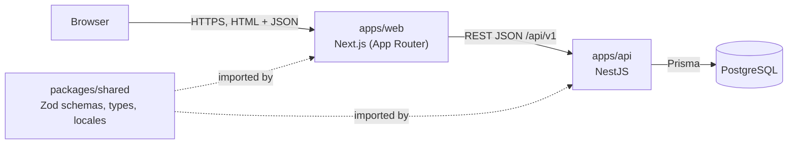
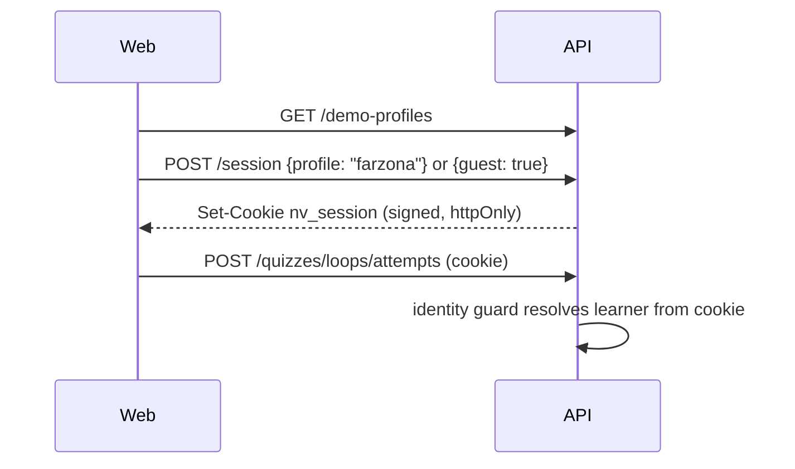

# System architecture

Status: **Approved** (G0 baseline, owner, 2026-10-25). Built on the decisions in [decisions.md](decisions.md).

## Overview



Two deployable apps plus one shared package in a single pnpm workspace (D-17) ([ADR-0002](adr/0002-monorepo-with-shared-schemas.md)).

## Responsibilities and boundaries

| | `apps/web` (Next.js) | `apps/api` (NestJS) | `packages/shared` |
| --- | --- | --- | --- |
| Owns | Routing, rendering, UI strings (i18n messages), theme, layout, motion, client caching | **All business rules**: scoring, mastery, recommendations, authorization, content locale resolution, persistence | Request/response Zod schemas and inferred types, enums, supported locales |
| Must not | Score quizzes, decide mastery, or talk to the database | Render HTML or hold UI strings (it returns stable error **codes**, not sentences) | Import from either app, or contain runtime dependencies beyond Zod |

The one rule that matters most: **the web app never decides learning outcomes.** It displays what the API computed. This keeps scoring trustworthy and the logic testable in one place.

## Module structure

### API (`apps/api/src`)

Feature modules, each with a controller (HTTP), a service (logic), and Prisma access inside the service. A separate repository layer isn't worth it at this size.

| Module | Responsibility | Main requirements |
| --- | --- | --- |
| `catalog` | Subjects, topics, prerequisites, knowledge-map data | FR-CAT, FR-MAP |
| `lessons` | Lesson content, mark complete | FR-LES |
| `resources` | Books and learning resources per topic. Currently served inside `GET /topics/:topicSlug` by `catalog`; a separate module only if resources get endpoints of their own | FR-RES |
| `quizzes` | Quiz delivery (without answers), attempt submission, scoring | FR-QUIZ |
| `progress` | Topic mastery, lesson progress, attempt history | FR-PROG, FR-JOUR |
| `recommendations` | Weak-topic rules and review suggestions ([ADR-0004](adr/0004-rule-based-mastery-and-recommendations.md)) | FR-ADAPT |
| `identity` | Demo profiles, guest creation, signed session cookie, current-learner guard ([ADR-0006](adr/0006-demo-profiles-and-guest-mode.md)) | FR-AUTH |
| `common` | Prisma service, config (Zod-validated env), error filter, locale resolution, Zod validation pipe | — |

Pure logic (scoring, mastery classification, recommendation ordering) is written as **plain functions** with no Nest or Prisma imports, so it can be unit-tested directly.

### Web (`apps/web`)

```text
src/
  app/[locale]/                 Routes (one segment per locale: tg | ru | en)
    page.tsx                    Homepage (hero + knowledge core, VISUAL_EXPERIENCE.md)
    subjects/[subjectSlug]/     Subject with ordered topics and status (knowledge map: planned)
    topics/[topicSlug]/         Topic: lessons, resources, quiz
    lessons/[lessonSlug]/       Lesson, mark complete
    quizzes/[quizSlug]/         Take quiz; results shown on the same page after submission
    progress/                   Mastery, attempts, recommendations
    status/                     API and database status (walking skeleton)
  features/<feature>/           Components and hooks per feature (home, learning)
  components/ui/                shadcn/ui components (generated, then owned)
  components/brand/             Logo component (switches light/dark asset)
  lib/                          API client, query client, i18n config, utils
messages/{tg,ru,en}.json        UI strings
```

Route segments use slugs, which are stable and readable (list checked 2026-10-26).

### Data fetching

- **Read-only content** (catalog, lessons, resources) is fetched in Server Components and rendered on the server. This means fast first paint and no client JS needed to read a lesson.
- **Learner-specific and interactive data** (quiz attempts, progress, recommendations, mark-complete) goes through **TanStack Query** in Client Components. Mutations invalidate the affected queries (e.g. submitting an attempt invalidates progress and recommendations).
- The API base URL comes from validated env config. Calls go through one typed client in `lib/api`, which parses responses with the shared Zod schemas.

## Authentication and authorization

**Requirements (fixed):**

- Progress and attempts belong to a learner and persist across reloads (FR-AUTH-01).
- A learner can only read or write their own progress and attempts (FR-AUTH-02). This is enforced in the API, never only in the UI.
- Content (catalog, lessons, quizzes without answers) is readable without being identified.
- No passwords or tokens stored in `localStorage`. Identity travels in an `httpOnly`, `SameSite=Lax`, `Secure` (in production) cookie.

**Mechanism: Approved ([D-03](decisions.md), [ADR-0006](adr/0006-demo-profiles-and-guest-mode.md)): seeded demo profiles plus guest mode, no passwords.**



- If a learner with no session starts a quiz or marks a lesson complete, the web app first calls `POST /session {guest: true}`, then continues. No sign-in wall.
- The header always shows the current learner and a "Demo" badge, with "Switch learner" and "Leave".
- Moving to real accounts later swaps only the `identity` module (see ADR-0006).

**Roles:** none in the MVP. Every learner has the same permissions. Roles (e.g. admin, teacher) arrive with real accounts.

**Not for public deployment:** demo profiles can be opened by anyone using the app. This is acceptable for the local presentation (D-10) only.

## Localization

- **Locales:** `ru` (Russian, **default** since 2026-10-26), `tg` (Tajik), `en` (English) ([D-06](decisions.md), Approved). The list, its order (used by the language switcher), and the default are defined once in `packages/shared/src/locales.ts` (`LOCALES`, `DEFAULT_LOCALE`).
- **UI strings:** message files per locale in the web app, loaded with **next-intl** ([D-05](decisions.md)). A key-parity test fails when any key is missing in any locale, so **UI strings never fall back**.
- **Routing:** the locale is the first URL segment (`/tg/...`). On a first visit, `/` redirects to the saved locale cookie if there is one, otherwise to `/ru`. Browser-language detection is **off**, so the demo laptop's system language can't change the default.
- **Language switcher:** in the header on every page. It shows each language by its native name (Русский, Тоҷикӣ, English) with a `lang` attribute, keeps the current page, saves a cookie, and updates `<html lang>`.
- **Content:** stored per locale in the database ([ADR-0003](adr/0003-localized-content-as-json.md)). The web app sends the active locale in `Accept-Language`, and the API defaults to `tg` when the header is missing.

### Content fallback strategy

| Requested | Fallback order |
| --- | --- |
| `tg` | `tg` → `ru` → `en` |
| `ru` | `ru` → `en` → `tg` |
| `en` | `en` → `ru` → `tg` |

Russian is the first fallback for Tajik because Tajik readers understand it more widely than English. Fallback is a safety net, not a plan:

- **Core demo content** (every subject, topic, lesson, quiz, question, option, explanation, and resource description in the demo subject) **must exist in all three languages**. The seed check fails if any is missing.
- Non-core content may fall back. The API lists such fields in `fallbackFields`, and the UI shows a "not yet translated" label with the correct `lang` attribute on the fallback text.

### Formatting (D-19)

Checked on 2026-10-25: Chromium has **no Tajik `Intl` data**, so `Intl.DateTimeFormat("tg")` silently formats as Russian. Node.js does have Tajik data. If the server and browser format the same value, they produce different text, which causes React hydration errors and inconsistent output. The rules:

- Dates use an explicit pattern: `dd.MM.yyyy` for all locales, or month names from our own message files. Never `Intl` month names for `tg`.
- Percentages are rendered as `{value}%` from message templates. Numbers in the MVP are small integers.
- Plurals: Tajik nouns don't change form after numerals, so Tajik messages use only the ICU `other` form. Russian messages use `one`/`few`/`many`/`other`.

### Fonts (D-07)

- **Inter** for all interface text. Checked on 2026-10-25 by rendering Google Fonts Inter (400 and 600) in Chromium: every Tajik letter (Ғ ғ Ӣ ӣ Қ қ Ӯ ӯ Ҳ ҳ Ҷ ҷ) and Russian Cyrillic rendered in Inter, with no glyph falling back to another font.
- Load it with `next/font/google` and the subsets `latin`, `cyrillic`, and `cyrillic-ext`. The Tajik letters are in `cyrillic-ext`.
- Poppins (Latin only) is used only for the tagline. The wordmark is a vector SVG and depends on no font.

## Theming

- Light, dark, and system modes, using the `class` strategy (`.dark` on `<html>`) via **next-themes** ([D-15](decisions.md)). It's the approach shadcn/ui documents, and it prevents the first-paint flash.
- Colours come only from semantic tokens. The brand primitives in [`assets/brand/tokens.css`](../../assets/brand/tokens.css) are mapped to shadcn/Tailwind theme variables as described in [design-system.md](../02-design/design-system.md#theme-tokens).

## Configuration

Each app validates its environment variables with Zod at startup and fails fast with a clear message. Planned variables (names may change at G1): `DATABASE_URL`, `DATABASE_URL_TEST`, `API_PORT`, `WEB_ORIGIN` (CORS), `SESSION_SECRET` (signs the learner cookie), `NEXT_PUBLIC_API_URL`.

## Local environment (checked 2026-10-25 on the owner's machine)

| Tool | Found | Notes |
| --- | --- | --- |
| Node.js | v24.15.0 | Supported by current Next.js, NestJS, and Prisma |
| npm / corepack | 11.12.1 / 0.34.6 | |
| pnpm | **not installed** | Approved as the package manager ([D-17](decisions.md)). Installing it is a G1 step that needs approval |
| PostgreSQL | **18.6, native Windows service**, port 5432, running | Approved for local development ([D-18](decisions.md)). Roles, databases, and configuration change only with owner approval. It currently listens on all network interfaces (see [security](../06-quality/quality-standards.md#security)) |
| Docker | **not installed** | Not required |

Confirm Prisma's support for PostgreSQL 18 during G1 (first migration). If it fails, use PostgreSQL 16 or 17 instead.

## Cross-cutting expectations

| Concern | Where it's defined |
| --- | --- |
| Error format and API conventions | [api-conventions.md](../03-api/api-conventions.md) |
| Entities and relationships | [data-model.md](../04-data/data-model.md) |
| Accessibility, performance, security, testing | [quality-standards.md](../06-quality/quality-standards.md) |
| Responsiveness, motion, components | [design-system.md](../02-design/design-system.md) |
