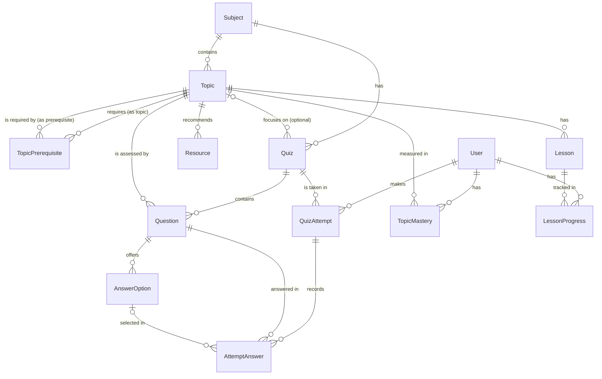

# Data model

Status: **Approved** (G0 baseline, owner, 2026-10-25). This is a conceptual model. The Prisma schema is written and approved at Gate G2. Field names may change then, but entities and relationships shouldn't without updating this document.

## Conventions

- PostgreSQL via Prisma. Model names are `PascalCase` singular. Table names are mapped to `snake_case` plural.
- Primary keys: `id` as `cuid()` strings.
- **Stable references for seeding (G2, decision 4):** subjects, topics, lessons, and quizzes have a `slug` that is **unique per entity type** (globally, not just within the parent), because API routes resolve them by slug alone (`/topics/:topicSlug`). Questions, answer options, and resources have a `key` that is unique within their parent (quiz, question, topic). Re-seeding upserts by slug or key, so it updates existing rows instead of creating duplicates.
- Every table has `createdAt` and `updatedAt`.
- `LocalizedText` = `jsonb` of `{ tg?, ru?, en? }` ([ADR-0003](../01-architecture/adr/0003-localized-content-as-json.md)), always validated with Zod.
- Deletion follows the [deletion policy](#deletion-policy): content cascades to other content, but never to learner history. Deleting a user cascades to their history.

## Entity relationship diagram (MVP)

## Entities

### Content (authored through seed files, read-only at runtime)

| Entity | Key fields | Notes |
| --- | --- | --- |
| **Subject** | `slug`, `title: LocalizedText`, `description: LocalizedText`, `order`, `isPublished` | |
| **Topic** | `subjectId`, `slug`, `title`, `summary` (LocalizedText), `order`, `mapX`, `mapY` | `mapX`/`mapY` are Knowledge Map positions (D-09) |
| **TopicPrerequisite** | `topicId`, `prerequisiteId` (both → Topic) | Composite PK. Same subject only, no cycles (seed check) |
| **Lesson** | `topicId`, `slug`, `title: LocalizedText`, `body: LocalizedText` (Markdown, D-12), `estimatedMinutes`, `order` | Worked examples and takeaways are sections inside `body` |
| **Resource** | `topicId`, `key` (unique per topic), `type` (`BOOK` \| `ARTICLE` \| `VIDEO` \| `EXERCISE`), `title: LocalizedText`, `author`, `url?`, `languages: Locale[]`, `whyUseful: LocalizedText`, `order` | "Recommended books and materials" |
| **Quiz** | `subjectId`, `topicId?`, `slug`, `title: LocalizedText`, `kind` (`TOPIC` \| `CHECKPOINT`) | A topic quiz has `topicId`. A checkpoint quiz (e.g. the JavaScript diagnostic) has no `topicId` and spans several topics; each question keeps its own `topicId`. Seed format: `checkpoints` in the content set (`defineCheckpoint`, one `topic` per question), loaded by the same create/update-only loader |
| **Question** | `quizId`, `topicId`, `key` (unique per quiz), `type` (`SINGLE_CHOICE`), `prompt: LocalizedText` (Markdown, may contain a Python code block), `explanation: LocalizedText` (Markdown), `order` | `topicId` drives weak-topic analysis. Multi-select etc. are Later |
| **AnswerOption** | `questionId`, `key` (unique per question), `text: LocalizedText`, `isCorrect`, `order` | Exactly one correct option per single-choice question (seed check). `isCorrect` is never sent before submission (FR-QUIZ-06) |

### Learner data (written at runtime)

| Entity | Key fields | Notes |
| --- | --- | --- |
| **User** | `kind` (`DEMO` \| `GUEST`), `demoSlug?` (unique, set for demo learners only), `displayName`, `preferredLocale?` | Demo learners are seeded. Guests are created by `POST /session`. No email, password, or role in the MVP ([ADR-0006](../01-architecture/adr/0006-demo-profiles-and-guest-mode.md)) |
| **QuizAttempt** | `userId`, `quizId`, `submittedAt`, `correctCount`, `totalCount`, `scorePercent` | Created on submission (MVP doesn't save in-progress attempts) |
| **AttemptAnswer** | `attemptId`, `questionId`, `selectedOptionId?`, `isCorrect` | `isCorrect` stored at scoring time, so history survives later content edits |
| **TopicMastery** | `userId`, `topicId`, `scorePercent`, `status` (`NOT_STARTED` \| `WEAK` \| `DEVELOPING` \| `MASTERED`), `lastAttemptId` | Unique on (`userId`, `topicId`). Rules in [ADR-0004](../01-architecture/adr/0004-rule-based-mastery-and-recommendations.md) |
| **LessonProgress** | `userId`, `lessonId`, `completedAt` | Unique on (`userId`, `lessonId`) |

Recommendations are **computed on request** from the tables above. They are not stored in the MVP.

### Teacher assessments (Faroz, migration `20261029120000_teacher_assessments`, owner-approved 2026-10-29)

| Entity | Key fields | Notes |
| --- | --- | --- |
| **Assessment** | `ownerKey` (staff slug or `acct:<accountId>`), `groupCode`, `subjectSlug`, `topicSlug?`, `title`, `purpose` (`CHECK` \| `RETEST` \| `DIAGNOSTIC`), `languages`, `audience` (`CLASS` \| `UNDER_60`), `opensAt?`, `closesAt?`, `timeLimitMinutes?`, `attemptsAllowed`, `revealAnswers`, `xp`, shuffle/notify flags, `publishedAt?` | Built by a teacher for one of their groups. Status is **derived**, not stored: draft (`publishedAt` null) → scheduled → live → closed by the real clock. Owners and groups are referenced by key because demo staff and groups are defined in code |
| **AssessmentQuestion** | `assessmentId` (cascade), `order` (unique per assessment), `topicSlug`, `sourceQuiz?`/`sourceKey?`, `prompt`, `code?`, `options`, `correctIndex`, `explanation` | A **snapshot**: bank questions are copied, so content edits never change a saved assessment. Text is jsonb `{ en, ru?, tg? }` (empty = not translated; students see English) |

These tables are separate from `quizzes` on purpose: the seed loader treats any quiz missing from the seed files as a blocking error. Learners cannot take teacher assessments yet (no attempt table for them). `pnpm db:seed:demo` removes demo teacher Dilshod's assessments and recreates the design's draft "Functions — return vs console.log".

### Center staff invitations and permissions (migration `20261029180000_staff_invitations_permissions`, owner-approved 2026-10-29)

| Entity | Key fields | Notes |
| --- | --- | --- |
| **StaffInvitation** | `orgKey` (`demo-center` or `org:<organizationId>`), `orgName`, `tokenHash` (unique), `name`, `email` (lower-case), `role` (TEACHER only for now), `subject`, `locale`, `invitedByKey`/`invitedByName`, `expiresAt`, `acceptedAt?`, `acceptedAccountId?` (→ Account, set null), `declinedAt?`, `revokedAt?` | Only the SHA-256 of the link token is stored. Status is derived: revoked → accepted → declined → expired → pending. Accepting records the account; the teacher keeps their own organization and groups |
| **CenterPermissions** | `orgKey` (PK), `coordGroups`, `coordStaff`, `teachCreate`, `teachShare`, `updatedByKey` | No row = handoff defaults. `coordGroups` and `coordStaff` are enforced by the center endpoints; the two teacher flags are stored only for now |

`pnpm db:seed:demo` deletes the demo center's invitations and its permissions row (back to the defaults). Teacher accounts created while accepting are not removed.

Theme preference is stored client-side (next-themes). Locale preference is stored in a cookie and optionally in `User.preferredLocale`.

The learner session is a signed cookie holding the `User.id`. There is no session table in the MVP.

**Demo data:** the seed creates the demo learners' attempts by running scripted answers through the real scoring and mastery functions, then stores the resulting `QuizAttempt`, `AttemptAnswer`, `TopicMastery`, and `LessonProgress` rows. Reseeding deletes all `GUEST` users and resets `DEMO` users.

## Later entities

Sketched so the MVP schema doesn't block them. **Do not create these tables in the MVP.**

| Entity | Purpose |
| --- | --- |
| `Account` (email, password hash), `Session`, `User.kind = REGISTERED`, roles | Real accounts, required before public deployment (FR-AUTH-05) |
| `Goal` (`userId`, `subjectId?`, `targetDate`, `targetTopics`) | Learning Journey goals (FR-JOUR-02) |
| `Achievement`, `UserAchievement` | Badges (FR-JOUR-03) |
| `Question.difficulty`, question bank tags | Adaptive question selection (FR-ADAPT-04) |
| `Class`, `Enrollment` | Teacher features |

## Deletion policy

Decision D-21 (owner, 2026-10-25). Enforced by foreign keys and tested in `apps/api/src/prisma/deletion-policy.spec.ts`.

**Learner history is never erased by content changes.** The five foreign keys from history tables to content use `ON DELETE RESTRICT`:

| History row | References | On content delete |
| --- | --- | --- |
| `QuizAttempt.quizId` | Quiz | **RESTRICT** |
| `AttemptAnswer.questionId` | Question | **RESTRICT** |
| `AttemptAnswer.selectedOptionId` | AnswerOption | **RESTRICT** |
| `TopicMastery.topicId` | Topic | **RESTRICT** |
| `LessonProgress.lessonId` | Lesson | **RESTRICT** |

What this means:

- **Content without learner history can be deleted.** Content-to-content links still cascade (subject → topics → lessons, resources, quizzes → questions → options).
- **Content with learner history cannot be deleted, directly or indirectly.** For example, deleting a subject whose quiz has attempts fails as a whole, with a foreign-key error, instead of silently removing those attempts. The seed loader must therefore never delete content rows. Retiring content is a later feature (an `isPublished`-style flag), not a delete.
- **User cleanup is unchanged.** Deleting a user cascades to their attempts, answers, mastery, and lesson progress. Guest cleanup and demo reset (ADR-0006) rely on this. An answer is always deleted together with its attempt.
- `TopicMastery.lastAttemptId` stays `SET NULL`. It only fires when an attempt itself is deleted, which happens through user cleanup.

### Published questions keep their meaning

`AttemptAnswer.isCorrect` is stored at scoring time, so scores survive content edits. But a re-opened result shows the question's *current* text, options, and explanation. Therefore, **once learners may have answered a question:**

- Fixing typos, translations, or explanation wording **in place** is fine.
- **Changing what the question asks, which option is correct, or what an option means is not.** Give the changed question a **new `key`** instead, so it becomes a new question. Removing the old one is a content deletion and is blocked while it has answers.
- The same applies to answer-option `key`s: never reuse a key for a different answer.

## Seed loader

`pnpm db:seed` (G3.1) writes the TypeScript seed content to the database. `pnpm db:seed:dry-run` prints the plan without writing. Code: `apps/api/src/seed/load/`.

1. **Validate first.** It runs the same checks as `pnpm seed:check`. Invalid content stops the run before any database query.
2. **Plan inside one transaction.** It reads the current content tables and compares them with the files by slug (subject, topic, lesson, quiz) or key (resource, question, option). It plans only creates and updates. Unchanged records produce no write, so re-running is a no-op.
3. **Block instead of guessing.** The run writes nothing if any of these hold:
   - Database content is missing from the files. **The loader has no delete operation**: restore the content in the files, or remove it deliberately outside the loader (subject to the [deletion policy](#deletion-policy)).
   - A record would move to a different parent (for example, a lesson slug reused under another topic).
   - A question with recorded answers would change its type, its options, or its correct option ([published questions keep their meaning](#published-questions-keep-their-meaning)). Text edits on answered questions are applied with a warning.
4. **Apply in dependency order, in the same transaction:** subjects → topics → prerequisites → lessons → resources → quizzes → questions → options. Any failure rolls back everything.

The loader writes content only. **Demo reset** is a separate command, `pnpm db:seed:demo` (run after `pnpm db:seed`; code: `apps/api/src/seed/demo/`). In one transaction it removes guest learners (their history cascades with the user) and rebuilds each scripted demo learner's lesson progress and attempts. The attempts are replayed through `recordAttempt()`, the same scoring and mastery code as real submissions ([ADR-0006](../01-architecture/adr/0006-demo-profiles-and-guest-mode.md), D-14). Content is never touched.

## Integrity rules (enforced by the seed check, and DB constraints where possible)

- Slugs are unique per entity type (subject, topic, lesson, quiz). Keys are unique within their parent (question within quiz, option within question, resource within topic).
- Prerequisite graph is acyclic and stays within one subject.
- Each single-choice question has exactly one correct option and at least 2 options.
- Topic quizzes have ≥ 3 questions (the MVP plan is 4). A checkpoint quiz has ≥ 3 questions per topic it covers.
- Every `LocalizedText` in the demo subject has **all three** locales (`tg`, `ru`, `en`). A missing one fails the seed (D-06). Other content needs at least one locale, and missing locales are reported as warnings.
- Exactly the scripted demo learners exist after seeding, and their stored mastery matches what the scoring functions compute.
