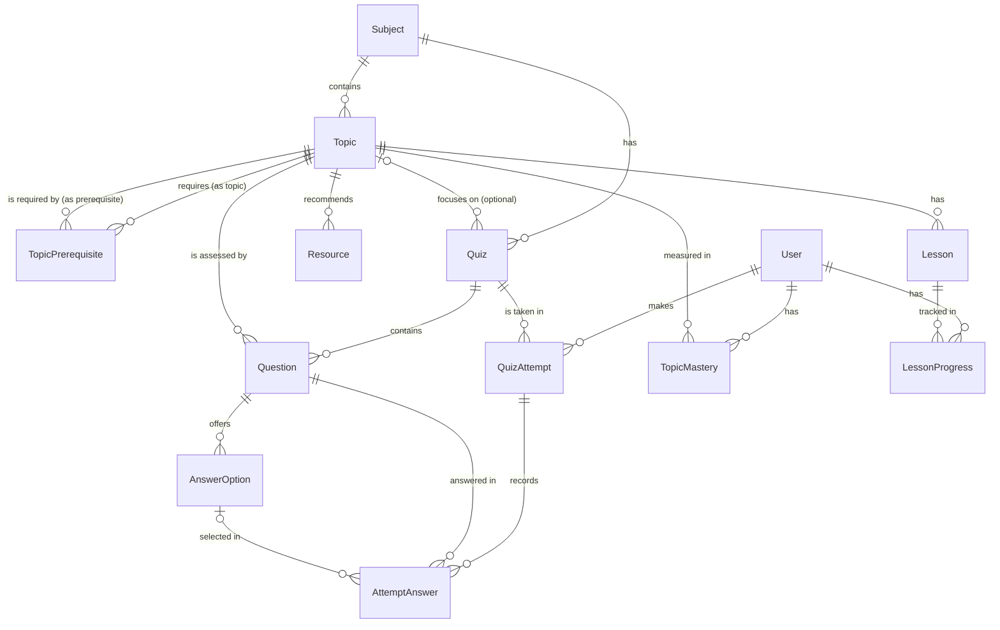

# Data model

Status: **Approved** (G0 baseline, owner, 2026-10-25). This is a conceptual model. The Prisma schema is written and approved at Gate G2. Field names may change then, but entities and relationships shouldn't without updating this document.

## Conventions

- PostgreSQL via Prisma. Model names are `PascalCase` singular. Table names are mapped to `snake_case` plural.
- Primary keys: `id` as `cuid()` strings. Content entities also have a unique, human-readable `slug`, which seed files use for stable references.
- Every table has `createdAt` and `updatedAt`.
- `LocalizedText` = `jsonb` of `{ tg?, ru?, en? }` ([ADR-0003](../01-architecture/adr/0003-localized-content-as-json.md)), always validated with Zod.
- Deleting content cascades to its children. Deleting a user cascades to their attempts and progress.

## Entity relationship diagram (MVP)

## Entities

### Content (authored through seed files, read-only at runtime)

| Entity | Key fields | Notes |
| --- | --- | --- |
| **Subject** | `slug`, `title: LocalizedText`, `description: LocalizedText`, `order`, `isPublished` | |
| **Topic** | `subjectId`, `slug`, `title`, `summary` (LocalizedText), `order`, `mapX`, `mapY` | `mapX`/`mapY` are Knowledge Map positions (D-09) |
| **TopicPrerequisite** | `topicId`, `prerequisiteId` (both → Topic) | Composite PK. Same subject only, no cycles (seed check) |
| **Lesson** | `topicId`, `slug`, `title: LocalizedText`, `body: LocalizedText` (Markdown, D-12), `estimatedMinutes`, `order` | Worked examples and takeaways are sections inside `body` |
| **Resource** | `topicId`, `type` (`BOOK` \| `ARTICLE` \| `VIDEO` \| `EXERCISE`), `title: LocalizedText`, `author`, `url?`, `languages: Locale[]`, `whyUseful: LocalizedText`, `order` | "Recommended books and materials" |
| **Quiz** | `subjectId`, `topicId?`, `slug`, `title: LocalizedText`, `kind` (`TOPIC` \| `CHECKPOINT`) | A topic quiz has `topicId`. The checkpoint quiz (MVP-Should) spans several topics |
| **Question** | `quizId`, `topicId`, `type` (`SINGLE_CHOICE`), `prompt: LocalizedText` (Markdown, may contain a Python code block), `explanation: LocalizedText` (Markdown), `order` | `topicId` drives weak-topic analysis. Multi-select etc. are Later |
| **AnswerOption** | `questionId`, `text: LocalizedText`, `isCorrect`, `order` | Exactly one correct option per single-choice question (seed check). `isCorrect` is never sent before submission (FR-QUIZ-06) |

### Learner data (written at runtime)

| Entity | Key fields | Notes |
| --- | --- | --- |
| **User** | `kind` (`DEMO` \| `GUEST`), `demoSlug?` (unique, set for demo learners only), `displayName`, `preferredLocale?` | Demo learners are seeded. Guests are created by `POST /session`. No email, password, or role in the MVP ([ADR-0006](../01-architecture/adr/0006-demo-profiles-and-guest-mode.md)) |
| **QuizAttempt** | `userId`, `quizId`, `submittedAt`, `correctCount`, `totalCount`, `scorePercent` | Created on submission (MVP doesn't save in-progress attempts) |
| **AttemptAnswer** | `attemptId`, `questionId`, `selectedOptionId?`, `isCorrect` | `isCorrect` stored at scoring time, so history survives later content edits |
| **TopicMastery** | `userId`, `topicId`, `scorePercent`, `status` (`NOT_STARTED` \| `WEAK` \| `DEVELOPING` \| `MASTERED`), `lastAttemptId` | Unique on (`userId`, `topicId`). Rules in [ADR-0004](../01-architecture/adr/0004-rule-based-mastery-and-recommendations.md) |
| **LessonProgress** | `userId`, `lessonId`, `completedAt` | Unique on (`userId`, `lessonId`) |

Recommendations are **computed on request** from the tables above. They are not stored in the MVP.

Theme preference is stored client-side (next-themes). Locale preference is stored in a cookie and optionally in `User.preferredLocale`.

The learner session is a signed cookie holding the `User.id`. There is no session table in the MVP.

**Demo data:** the seed creates the demo learners' attempts by running scripted answers through the real scoring and mastery functions, then stores the resulting `QuizAttempt`, `AttemptAnswer`, `TopicMastery`, and `LessonProgress` rows. Reseeding deletes all `GUEST` users and resets `DEMO` users.

## Later entities

Sketched so the MVP schema doesn't block them. **Do not create these tables in the MVP.**

| Entity | Purpose |
| --- | --- |
| `Account` (email, password hash), `Session`, `User.kind = REGISTERED`, roles | Real accounts, required before public deployment (FR-AUTH-05) |
| `Goal` (`userId`, `subjectId?`, `targetDate`, `targetTopics`) | Learning Journey goals (FR-JOUR-02) |
| `Achievement`, `UserAchievement` | Badges (FR-JOUR-03) |
| `Question.difficulty`, question bank tags | Adaptive question selection (FR-ADAPT-04) |
| `Class`, `Enrollment` | Teacher features |

## Integrity rules (enforced by the seed check, and DB constraints where possible)

- Slugs are unique within their parent (topic slug within subject, etc.).
- Prerequisite graph is acyclic and stays within one subject.
- Each single-choice question has exactly one correct option and at least 2 options.
- Topic quizzes have ≥ 3 questions (the MVP plan is 4). A checkpoint quiz has ≥ 3 questions per topic it covers.
- Every `LocalizedText` in the demo subject has **all three** locales (`tg`, `ru`, `en`). A missing one fails the seed (D-06). Other content needs at least one locale, and missing locales are reported as warnings.
- Exactly the scripted demo learners exist after seeding, and their stored mastery matches what the scoring functions compute.
